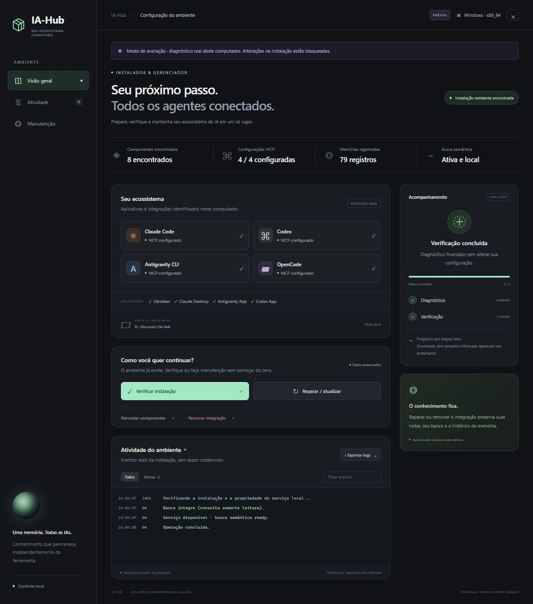
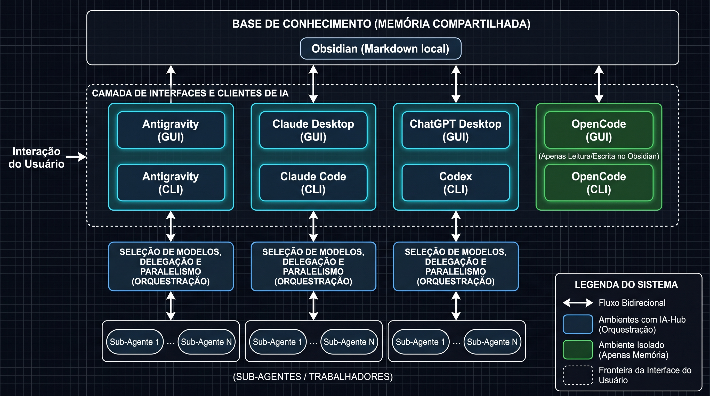

# IA-Hub

Memória compartilhada (Obsidian) para **Antigravity, Claude, ChatGPT/Codex e OpenCode** e orquestração operacional (seleção de modelos, delegação e paralelismo) para os três primeiros. A política busca o modelo suficiente para a tarefa; memória, métricas e Obsidian sustentam a continuidade entre sessões.

**Dois instaladores autocontidos:** `instalar.cmd` para Windows e `instalar.sh` para Linux. Cada arquivo contém os scripts, configurações padrão e interface. Não precisa copiar outras pastas, instalar Python/Node previamente ou manter o clone depois de instalar. Internet e login nas suas contas continuam necessários.



> Imagem de uma verificação real no Windows. A prévia é somente leitura. Detectar um app ou um MCP configurado não comprova captura de todas as conversas desse aplicativo.

## Arquitetura



| Ambiente | GUI | CLI | Memória (Obsidian) | Orquestração |
|---|---|---|---|---|
| Antigravity | App: MCP configurado | `agy`: MCP + hooks de contexto/captura | sim | despacho via MCP |
| Claude | Desktop: registro MCP (sem hook de prompt) | Claude Code: mod + hooks + MCP | sim | **mod troca o modelo antes da inferência**; MCP despacha sub-agentes |
| ChatGPT / Codex | Apps: dependem de MCP/conector da sessão | Codex CLI: MCP + observador de respostas | sim | despacho via MCP (não troca o modelo da conversa aberta) |
| OpenCode | memória apenas | plugin de contexto + captura | sim | **nenhuma por desenho** (sem plugin de roteamento, sem agentes, sem tools de orquestração) |

Diferença GUI × CLI: só o Claude Code expõe hooks/mod que alteram o modelo e o contexto de cada prompt automaticamente. Nos apps gráficos o IA-Hub entrega as ferramentas MCP (memória e, exceto no OpenCode, orquestração); a conversa aberta só as usa se o modelo as chamar. O instalador não promete interceptação onde o aplicativo não oferece mecanismo oficial.

Isolamento do OpenCode, aplicado em código: o MCP `ia_hub` do OpenCode não registra as ferramentas `orchestration_*`; o serviço recusa qualquer ação `orchestration_*` com `client=opencode`; o roteador rejeita o cliente; o plugin só lê contexto e grava a resposta final. A instalação remove agentes e chaves de configuração do hub antigo no OpenCode (somente os que correspondem exatamente ao conteúdo gerado antes; personalizações ficam) e faz backup.

## Instalação rápida

Baixe **somente o instalador do seu sistema** pelo GitHub, autenticado se o repositório exigir. Alternativamente, clone:

```sh
git clone https://github.com/splt5k/ia-hub-setup.git
cd ia-hub-setup
```

### Windows x86_64

Abra `instalar.cmd` com dois cliques ou execute no PowerShell:

```powershell
.\instalar.cmd
```

O bootstrap prepara uv/Python temporários e abre o painel no navegador. Usa fontes oficiais para os CLIs e `winget` para os apps gráficos; tenta preparar o Windows App Installer se necessário. Políticas da máquina, indisponibilidade da Store e permissões podem deixar componentes pendentes.

### Linux x86_64

```sh
chmod +x instalar.sh
./instalar.sh
```

Execute como usuário normal, **sem sudo no comando principal**. Dependências de sistema e pacotes de alguns apps podem solicitar sudo separadamente.

- **Sessão gráfica ativa:** painel; tenta instalar também os apps oficiais compatíveis com a distribuição.
- **Servidor, SSH ou WSL:** terminal, quatro CLIs e memória; não instala apps gráficos por padrão.
- Requer glibc 2.28+ e ferramentas básicas de extração. Tenta preparar curl, certificados, tar e unzip pelos gerenciadores reconhecidos. Alpine/musl não está suportado.
- ARM64 possui caminhos no instalador, mas **não foi validado**. O alvo testado é x86_64.

Depois, **entre nas contas e reabra os clientes** para carregar MCPs e hooks. Assinaturas, consentimentos e confiança de workspace continuam sob seu controle.

## Instalação e manutenção

O instalador verifica e extrai o pacote em uma pasta temporária exclusiva, identifica integrações existentes e prepara componentes ausentes. O painel oferece progresso por etapas reais e logs exportáveis. Downloads sem tamanho informado aparecem em andamento.

| Ação | Resultado |
|---|---|
| Instalar | Prepara clientes, configurações, serviço, Python isolado e modelo semântico local (~220 MB); valida gravação/leitura, recuperação semântica e integridade |
| Verificar | Diagnóstico somente leitura; não inicia nem reconfigura a memória |
| Reparar / atualizar | Atualiza código gerenciado, tenta resolver pendências e preserva componentes presentes |
| Reinstalar componentes | Exige seleção e confirmação; faz backup antes de substituir o runtime |
| Remover integração | Exige confirmação; desconecta registros gerenciados e preserva aplicativos, banco, notas e histórico |

**Em um PC já configurado:** reutiliza a pasta identificada. Se as integrações dos clientes pertencem a **outra** pasta (por exemplo, uma versão antiga do hub), o instalador recusa por padrão e não altera nada. Para instalar numa pasta nova e substituir os MCPs/hooks/tarefas antigos (com backup, sem tocar na pasta antiga nem nos seus cofres do Obsidian):

```powershell
$env:IA_HUB_INSTALL_DIR = "$env:LOCALAPPDATA\IA-Hub"; $env:IA_HUB_REPLACE_LEGACY = '1'; .\instalar.cmd --cli
```

(Linux: `IA_HUB_INSTALL_DIR=... IA_HUB_REPLACE_LEGACY=1 ./instalar.sh`.) A porta padrão é 43127; se outro serviço a ocupa, esta instalação usa a próxima livre e a grava em `contexto/.memory/port`. O serviço de outra instalação nunca é encerrado. Se o Obsidian já tem cofres, o instalador só adiciona o hub à lista e não altera o atalho do Iniciar.

Configurações recebem backups. Na atualização do pacote, arquivos pessoais existentes em `regras/`, `modelos/`, `claude/`, `opencode/`, `chatgpt/` e configurações do cofre são preservados. Os clientes recebem os ajustes gerenciados; MCPs externos, hooks personalizados e dados de outros programas são preservados pelos mecanismos do instalador.

### Pasta definitiva

| Sistema | Destino padrão em instalação nova |
|---|---|
| Windows | `%LOCALAPPDATA%\IA-Hub` |
| Linux | `$XDG_DATA_HOME/ia-hub`, ou `~/.local/share/ia-hub` |

Não é necessário ter unidade `D:`. Para escolher outro destino **antes da primeira instalação**:

```powershell
$env:IA_HUB_INSTALL_DIR = 'C:\MeusDados\IA-Hub'
.\instalar.cmd
```

```sh
IA_HUB_INSTALL_DIR="$HOME/MeusDados/IA-Hub" ./instalar.sh
```

Use a pasta indicada pelo painel para diagnosticar ou personalizar uma instalação existente. MCPs e mecanismos de inicialização usam caminhos absolutos: não mova a pasta instalada sem migrar/reconfigurar as integrações.

### Permanente versus temporário

- **Permanece:** serviço e código, SQLite, histórico, notas `Memoria/`, regras, configurações, backups, modelo e runtime `.memory-runtime/`. O Python base necessário ao serviço fica em `.tools/python`, fora da extração temporária.
- **É limpo:** payload extraído, uv/Python da interface, downloads e cache do instalador. No terminal, na saída; no painel, use **Encerrar painel** depois de exportar os logs desejados.

Fechar somente a aba mantém o painel disponível até 30 minutos sem atividade. Encerrar o painel não encerra o cérebro compartilhado. Falhas tratadas também passam pela limpeza; queda de energia ou encerramento forçado podem deixar a pasta temporária daquela execução. Falhas de limpeza são informadas. Caches dos próprios aplicativos e do sistema não são apagados.

Pode remover o arquivo baixado ou o clone após instalar. **A pasta definitiva contém seus dados: preserve-a.** Backups de segurança não são lixo temporário e não são apagados automaticamente.

## Orquestração implementada nesta evolução

O serviço existente decide modelo/esforço por regras determinísticas, sem chamar outro LLM para classificar todo prompt. A política em `regras/orchestration.json` permite ajustar modelos e limites. Os níveis de custo são ordinais: não representam preços verificados nem garantem o menor custo global.

| Ambiente | Controle efetivo | Limite |
|---|---|---|
| Claude Code ≥2.1.287 | Mod altera modelo antes da inferência; escolhe modelo de novas delegações | Retomadas/workflows preservados; orçamento de dois agentes é local, sem prova de atomicidade do runtime |
| OpenCode | Nenhum (ambiente somente de memória, conforme o diagrama) | Não participa da seleção de modelos nem da delegação |
| Codex CLI/App local | MCP executa trabalhos delegados via CLI com modelo/esforço definidos | Não troca o modelo da conversa aberta automaticamente |
| Antigravity CLI | Despacho com modelo definido e permissões nativas | Interceptação do modelo da GUI não comprovada |
| Claude Chat e ChatGPT convencional | Dependem dos conectores disponíveis na sessão | Configurar o CLI não concede controle sobre essas conversas |

`orchestration_plan` retorna decisão e motivos. `orchestration_run` inicia trabalho delegado de leitura/análise; `orchestration_status` entrega resultado/validação; `orchestration_report` exporta métricas do ledger no mesmo SQLite. Execução continua usando o login nativo, sem copiar credenciais nem trocar de provedor silenciosamente.

O executor limita a dois workers e duas tentativas por tarefa, com uma escalada após falha de validação. Paralelismo exige subtarefas explicitamente independentes e benefício esperado declarado; não divide automaticamente qualquer texto em agentes. Não amplia permissões para contornar uma falha. Validações suportadas: texto exato, trecho obrigatório e JSON válido; isso não equivale a validar qualquer conclusão técnica.

Para preservar sua escolha manual, inicie o Claude Code com `IA_HUB_ROUTING_MODE=manual`. Depois da instalação/reparo, abra uma nova sessão ou recarregue os plugins. O relatório `contexto/.memory/installation.json` diferencia mod instalado de instalação pendente; hooks de memória permanecem como alternativa quando mods não estão disponíveis.

Custos ausentes ficam nulos. Custos reportados são estimativas do cliente, não a fatura da assinatura. Cache tem semânticas diferentes por harness; não some os campos cegamente. O relatório de uma execução do dispatcher inclui filhos e tentativas; a telemetria nativa ainda marca cobertura incompleta dos subagentes. Nenhuma porcentagem de economia universal é prometida.

Veja [contratos nativos](https://github.com/splt5k/ia-hub-setup/blob/source/orquestracao-v1/docs/native-control-evidence.md) e [provas do mod Claude](https://github.com/splt5k/ia-hub-setup/blob/source/orquestracao-v1/docs/claude-mod-results.md) nas fontes desta evolução. O piloto real Claude ↔ Codex passou nos dois sentidos. O comparativo de oito chamadas passou nas oito respostas exatas: houve menor estimativa de custo no Claude/Haiku, mas nenhuma redução de tokens demonstrada no Codex; cache e amostra pequena impedem generalização.

## Memória compartilhada

O MCP `ia_hub` usa serviço autenticado somente em `127.0.0.1` (porta 43127 ou a próxima livre), SQLite com revisões, busca textual FTS5 e embeddings multilíngues locais. Não publica a memória na internet.

- Títulos legíveis e IDs estáveis nos metadados.
- Wikilinks entre assuntos, projetos, decisões e descobertas, por contexto e afinidade semântica; índice sem centralizar artificialmente o grafo.
- Importação incremental das fontes antigas preservando originais e histórico; deduplicação e atualizações por chave estável.
- Relatos automáticos são `reported`, não fatos confirmados. Registrar decisões relevantes por `memory_store`; `validated` exige evidência.
- Obsidian abre a **pasta definitiva** como cofre; não precisa permanecer aberto.

Conteúdo recuperado é evidência, nunca instrução confiável por si só. Quando uma IA o utiliza como contexto, ele é enviado ao provedor daquele ambiente conforme suas permissões. Não coloque segredos na memória; a redação automática de credenciais é parcial.

### Capacidades por ambiente

| Ambiente | Leitura e escrita | Captura / contexto automático |
|---|---|---|
| Claude Code | MCP; troca entre agentes validada | Hooks de contexto e captura de respostas finais validados neste PC |
| Codex CLI / App local | MCP; CLI validado em sessões reais | Observador de respostas finais; recuperação em novas sessões do Codex validada |
| Antigravity CLI | MCP validado | Hooks e captura validados na versão 1.3.5 |
| OpenCode | MCP (somente memória) | Plugin de contexto e observador do banco local |
| Claude Desktop | Registro MCP no Windows; recarregar e validar a sessão | Captura universal das conversas comuns não comprovada; aba Code usa a integração Claude Code |
| Antigravity App | Configuração disponível; requer validação própria | Captura de conversas gráficas não comprovada |
| ChatGPT convencional, app/web | Depende de ponte/conector disponível à conversa | Instalar Codex ou copiar instruções não concede acesso automático |

Os mecanismos dependem dos formatos de logs, hooks e banco dos clientes instalados. Instalar um aplicativo não comprova leitura, escrita ou captura nele. O teste do instalador comprova o serviço; não autentica agentes nem valida cada app gráfico.

**Compartilhada entre IAs do mesmo PC não significa sincronizada entre PCs.** O pacote não contém memória privada. Um PC novo começa com uma base nova; restaurar/sincronizar dados anteriores é uma operação separada. Não ative escritores Windows e WSL simultâneos sobre o mesmo banco.

### Apps e inicialização no Linux

Obsidian e Antigravity App usam pacotes oficiais e launchers do usuário. Claude Desktop usa pacote oficial para Ubuntu 22.04+/Debian 12+; ChatGPT/Codex App tem instalação automatizada para Ubuntu 24.04/26.04, Debian 13 e Fedora 43/44. Em outras distros, os CLIs podem funcionar enquanto apps sem método automatizado ficam pendentes. Bibliotecas gráficas, sandbox e permissões continuam necessários.

Esses caminhos estão implementados; **abertura dos apps Linux e instalação privilegiada dos DEB/RPM não foram testadas** nesta validação. O serviço usa systemd do usuário quando disponível, com alternativas por login/autostart e início sob demanda. Não habilita linger nem promete execução antes do login.

## Opções e diagnóstico

| Opção | Windows | Linux |
|---|---|---|
| Sem argumentos | Painel | Detecta painel ou terminal |
| `--cli` | Terminal | Terminal |
| `--preview` | Painel somente leitura | Painel somente leitura |
| `--self-test` | Testa extração sem instalar dependências | Testa extração sem instalar dependências |
| `--help` | Ajuda, sem instalar | Ajuda, sem instalar |
| `--headless` / `--desktop` | — | Força modo de instalação |
| `--ui` | — | Força painel |
| `--memory-only` | — | Prepara memória/integrações sem instalar clientes/apps |

`--preview` ainda baixa o runtime temporário se necessário; não aplica alterações à instalação. `--self-test` verifica integridade e extração, sem comprovar instalação completa nem login.

No painel, exporte texto ou JSON. Credenciais comuns são redigidas; revise os relatórios antes de compartilhar. A pasta definitiva guarda `contexto/bootstrap.json` e `contexto/.memory/doctor.json`. `semantic_state: ready` indica modelo carregado; erros, projeções pendentes e conflitos aparecem no diagnóstico.

No terminal, saída **0** indica conclusão; **2**, componentes pendentes/falhos; **1**, erro que interrompeu a operação. No painel, instalação parcial fica indicada até encerrar. Corrija a causa e execute novamente; não renomeie/apague o banco para resolver falhas de rede ou modelo.

Depois de instalar, personalize `regras/` na pasta definitiva. No Windows, `sincronizar.cmd` aplica as regras; no Linux, reexecute Reparar para reaplicar integrações. Esses arquivos estão embutidos no pacote e são instalados no destino correto.

## Validação

Detalhes, comandos e limites em [docs/validacao.md](docs/validacao.md); métricas e matriz por ambiente em [docs/eficiencia.md](docs/eficiencia.md).

**Comprovado em execução real (2026-10-15):** 14 testes automatizados com daemon e SQLite reais; instalação completa e reexecução idempotente no Windows (`instalar.cmd`) e no Ubuntu/WSL (`instalar.sh`, `tools/validate-linux.sh`); limpeza do temporário; memória cruzada Claude Code → OpenCode (CLI) e OpenCode → memória; troca nativa de modelo no Claude Code (`sonnet` configurado, `haiku` executado); despacho validado no Claude Code e no Antigravity; OpenCode sem nenhuma execução no ledger de orquestração.

**Não comprovado ou impedido:** leitura/execução real no Codex (limite de uso da conta durante os testes); qualquer app gráfico (Claude Desktop, ChatGPT/Codex App, Antigravity App, OpenCode GUI) em sessão autenticada; Windows recém-formatado, Linux com interface gráfica, outras distros, ARM64 e systemd real; ganho de custo em tarefas complexas. O SHA256 embutido verifica integridade, **não é assinatura digital**.

## Código-fonte e novas versões

O código vive em `src/` (payload completo), os instaladores são **gerados** por `tools/build.py` e os testes ficam em `tests/`:

```sh
python -m unittest discover -s tests -v   # inclui a guarda de sincronia fonte <-> instalador
python tools/build.py                     # regenera instalar.cmd e instalar.sh
python tools/build.py --check             # falha se os instaladores não refletem src/
```

A geração é determinística (mesmo `src/` → mesmos bytes), com SHA256 embutido. Não edite o Base64 manualmente. Os modelos de cabeçalho dos instaladores estão em `tools/templates/`. O histórico anterior permanece na tag [source/orquestracao-v1](https://github.com/splt5k/ia-hub-setup/tree/source/orquestracao-v1).
